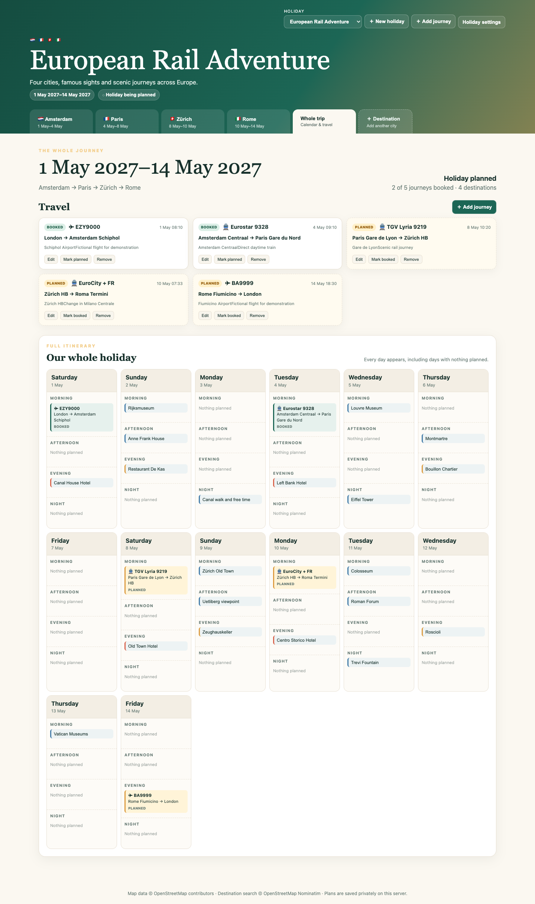
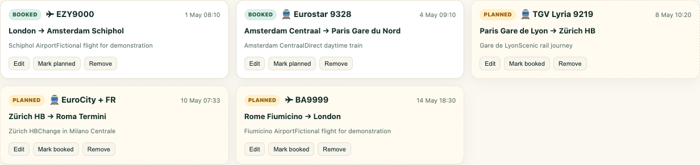

# Holiday Planner

A lightweight, self-hosted web app for planning single- or multi-destination holidays. It combines maps, places, flexible day planning and travel bookings in one responsive interface.



## Features

- Any number of holidays and destinations
- Automatic destination maps and country flags
- Photographic destination banners for any trip, with Wikimedia Commons image search and local image caching
- Cityscape, aerial, landmark, landscape and street photo suggestions, crop controls and four heading styles
- Whole-trip photo collage and preserved photographer/licence credits
- Destination day countdowns, updating to arrival, in-progress and completed status
- Bookmarkable holiday and destination URLs that survive refresh, with matching browser titles
- Hotels with check-in/check-out ranges, plus restaurants, bars, sights and free-text ideas
- Google Maps links, including shortened mobile sharing links
- Map-pin popups that show and update each place's calendar assignment
- Editable destination information cards for visas, health notes, useful phrases and links
- Full-day, morning, afternoon, evening and night scheduling
- Journey entry from either a destination or the whole-trip view
- Transport displayed inside destination and whole-trip calendars
- Whole-trip calendar with every day shown
- Whole-trip packing and to-do checklists
- Flights, trains, ferries, coaches, cars, taxis and custom journeys
- Planned/booked status for holidays and journeys
- City, beach, wildlife, winter, road-trip and colour themes
- Automatic previous-holiday grouping
- SQLite storage and cached OpenStreetMap tiles
- Printable itineraries and downloadable PDFs (ReportLab), with separate accommodation and travel details
- Editable hotel contacts and airport/station addresses, with optional OpenStreetMap lookup suggestions

## Quick start

Requires Python 3.9 or newer.

```bash
git clone https://github.com/ChimeraX-CMRX/holiday-planner.git
cd holiday-planner
python3 -m venv .venv
. .venv/bin/activate
python3 -m pip install -r requirements.txt
HOLIDAY_HOST=127.0.0.1 HOLIDAY_PORT=7070 python3 server.py
```

Open `http://127.0.0.1:7070`.

The database and tile cache are created on first run. They are deliberately excluded from Git.

## Configuration

All runtime settings are optional environment variables:

| Variable | Default | Purpose |
|---|---|---|
| `HOLIDAY_HOST` | `0.0.0.0` | Listen address. Use `127.0.0.1` behind a reverse proxy. |
| `HOLIDAY_PORT` | `7070` | Listen port. Choose any unused port. |
| `HOLIDAY_DB_PATH` | `./holiday-planner.sqlite3` | SQLite database location. |
| `HOLIDAY_TILE_CACHE` | `./tile-cache` | Map tile cache location. |
| `HOLIDAY_BANNER_CACHE` | `./banner-cache` | Cached Wikimedia Commons banner photographs. |

Example on a LAN:

```bash
HOLIDAY_HOST=0.0.0.0 \
HOLIDAY_PORT=8085 \
HOLIDAY_DB_PATH=/srv/holiday-planner/data/planner.sqlite3 \
HOLIDAY_TILE_CACHE=/srv/holiday-planner/data/tiles \
python3 server.py
```

Other devices would then visit `http://SERVER_IP:8085`. Allow the chosen port through the host firewall if required. Do not expose the app directly to the public Internet without authentication and a properly configured reverse proxy.

## systemd installation

1. Copy the repository to `/opt/holiday-planner`.
2. Create a dedicated unprivileged user, for example `website`.
3. Create `/opt/holiday-planner/data` and give that user write access.
4. Copy `holiday-planner.env.example` to `/etc/default/holiday-planner` and adjust the paths, IP and port.
5. Copy `holiday-planner.service` to `/etc/systemd/system/holiday-planner.service`.
6. Enable it:

```bash
sudo systemctl daemon-reload
sudo systemctl enable --now holiday-planner
sudo systemctl status holiday-planner
```

The supplied unit includes common systemd hardening and only grants write access to `/opt/holiday-planner`.

## Fictional demo

Create a completely fictional two-week European rail holiday:

```bash
python3 demo_seed.py --database demo.sqlite3
HOLIDAY_DB_PATH="$PWD/demo.sqlite3" HOLIDAY_PORT=7071 python3 server.py
```

The demo contains Amsterdam, Paris, Zürich and Rome; fictional flight/service numbers; rail journeys; famous landmarks; restaurants; and scheduled morning, afternoon, evening and night activities. It contains no real traveller, account or booking data.




## Destination banners

Every existing and new destination defaults to an automatic photograph found using its name and country. Use **Banner appearance** in the banner, or **Edit destination → Banner appearance**, to search by category or a landmark name, choose a photograph, adjust its horizontal/vertical crop and preview heading styles. Save the destination to keep your choice. The same editor is available when adding any future destination. Choose **Plain banner** to turn photography off. Whole trip combines up to four destination photographs.

Automatic selections are remembered until the destination name, country or photo category changes. Search results are cached for seven days; downloaded images are kept on the server. If Wikimedia is unavailable or has no suitable photo, the banner uses a readable fallback and the planner still works. Photo selection is optional: automatic search never blocks saving a destination. Search terms contain the destination/country or the custom photo query, not holiday dates or booking details. No API key is required.

Images are landscape JPEGs with supported public-domain, CC0, CC BY or CC BY-SA metadata from Wikimedia Commons. **Photo credits** links each image to its Commons file page and licence, identifies its author and notes the display crop. Image rights remain with their respective creators; they are not covered by this repository's MIT licence. Metadata is stored with the database and must be retained with exported plans. Only Wikimedia image hosts are fetched by the banner image endpoint.

Heading fonts are self-hosted: **Barlow Condensed** by Jeremy Tribby and **Cormorant Garamond** by Christian Thalmann, from the [Google Fonts repository](https://github.com/google/fonts), under the SIL Open Font License. Their licence files are in `fonts/`. Editorial and Modern use system fonts. These are visual styles, not official city fonts.

## Data and backups

### Printable itinerary

Open **Whole trip → Sharable travel itinerary / PDF**. The report includes every date, destination areas, hotel check-in/check-out ranges and all journeys (both departure and arrival events, including overnight flights). It excludes sightseeing, restaurants, information cards, checklists and the dedicated booking-reference field. Journey notes and terminal/station text are included, so check them for private information before sharing an itinerary. Hotels have their own Accommodation section in the regular calendars, separate from Full day activities.

The printable page has editable contact fields and explicit **Look up address / phone** buttons. Search by hotel or airport/station name and country, review the OpenStreetMap candidates, choose the correct location and save. Lookups are cached for 30 days and throttled to at most one request per 1.1 seconds. Only public place names/search terms are sent; dates, booking references and other saved plans are not. Missing phone numbers remain missing. Add official source URLs and verification notes when checking details yourself. There is no automatic bulk contact scraping or automatic overwriting of saved contacts.

Flight times always come from saved journeys and are displayed as local times at each endpoint. The app does **not** claim live or independently verified flight schedules. Airline-prefix hints identify marketing carriers only; operating airlines and codeshare numbers must be checked against the booking. Date-specific schedule verification generally requires an airline booking or a licensed flight-data service; neither credentials nor private bookings are sent to a third party. Edit journey times in the main planner, and contact/airport/operator details in the itinerary. Missing data is labelled. Source links and verification notes remain on the web page for checking but are excluded from PDF and print output, as are empty-calendar travel placeholders.

PDF downloads require `reportlab` (see `requirements.txt`). The browser print view still works without it. For systemd, point `ExecStart` to the virtual environment's Python if using a virtual environment. On Debian, `apt install python3-reportlab` also works with the system Python. PDFs embed the included Bitstream Vera fonts; their licence is in `fonts/bitstream-vera-license.txt`. No generated itinerary, contact data or personal trip database belongs in Git; back up the SQLite database, which stores contact details and their source links. Offline checks: `python3 -m unittest test_banners test_itinerary`.

Select a holiday and destination (or Whole trip), then bookmark or copy the current address. Links use stable IDs, for example `/?holiday=1&destination=3` or `/?holiday=1&destination=overall`; renaming a holiday or destination does not break its bookmark. Past holidays can also be opened directly. Deleted or invalid selections fall back to an available destination. Countdowns use the calendar date on the device viewing the planner.

Everything personal is in the SQLite file configured by `HOLIDAY_DB_PATH`. Back up that file while the service is stopped, or use SQLite's online backup tooling. Never commit it to source control.

Map tiles come from OpenStreetMap and destination lookup uses Nominatim. Follow their usage policies if deploying for substantial traffic.

## Security notes

- Run as an unprivileged account.
- Keep the app on a trusted network, VPN or authenticated reverse proxy.
- Set `HOLIDAY_HOST=127.0.0.1` when a reverse proxy is on the same machine.
- Restrict access to the selected port with a firewall.
- Treat the database as private: it can contain travel plans and booking references.

## Licence

MIT. Map data © OpenStreetMap contributors.
